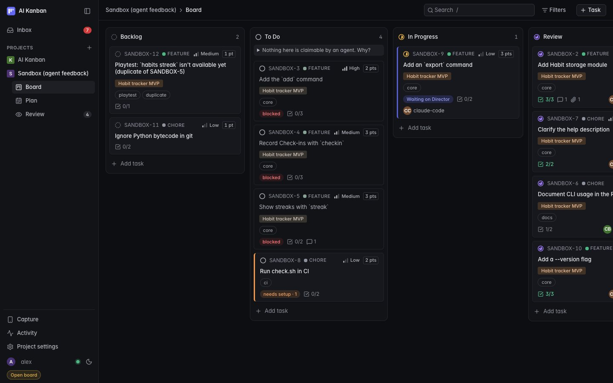

# AI Kanban

A self-hosted Jira-style board for AI coding agents. Tasks live in a SQLite database inside a Docker volume,
**not in your repo**, and agents work them through a REST API or MCP. You watch and steer from a live web board.

Throughout the board and these docs, **the Director** is you: the human who sets priorities, answers agents'
questions and accepts or sends back their work. Everyone else is an agent.



- **Agent-first API**: atomic claim / claim-next (two agents never get the same task), dependencies that
  block work until done, comments, full activity log, bulk create, task keys like `APP-12`.
- **Priority-ordered**: columns sort highest priority first, and agents always get the most important unblocked task.
- **Epics and sprints**: epics group tasks into features; sprints are the plan (what gets built together, in
  what order), shown on the **Plan** view with story points and progress. Agents can plan both.
- **Milestones**: group tasks toward dated goals, with progress bars.
- **Briefings, not guesswork**: tasks carry acceptance criteria and context (files and docs to read first), and
  each project has an **agent brief** of standing conventions. A claim returns all of it in one response.
- **Review inbox**: agents submit a structured handoff (summary, branch, commit, files, how to verify,
  screenshots). You **Accept** it or **Request changes**, which sends it back to the same agent as its next task,
  with your feedback.
- **Quick capture**: a phone-friendly page (`/capture`) that turns a one-line note plus screenshots into a
  backlog task labeled `capture`, ready for you or an agent to triage.
- **Director inbox**: one view of everything waiting on you, oldest first: agents' questions, reviews (with the
  criteria only you can check), setup steps blocking agents, gates assigned to you, and stale claims.
- **Drift guards**: Director-owned criteria and evidence, blocking questions that become recorded Decisions,
  prerequisites that block claiming, upstream handoffs in briefings, required checks, scoped briefs, required
  fields, a glossary lint, resume notes, and (with a read-only `repo_path`) commit/file/scope validation on submit
  plus warnings when a task's context docs changed or a rule ID it cites no longer exists.
- **MCP server** built in, so Claude Code, Cursor, Codex or any other MCP client gets native tools.
- **Self-documenting**: agents can `GET /api/guide` to learn the workflow; OpenAPI at `/api/openapi.json`.
- **Live board**: drag and drop, edit anything, comment, activity feed. Updates stream in as agents work.
- **Zero dependencies**: Node built-ins only (`node:http`, `node:sqlite`). No npm install, no build step.

## Run it

```bash
git clone <this repo> ai-kanban && cd ai-kanban
docker compose up -d --build
open http://localhost:8080
```

The first screen asks you to create a project. Data persists in the `kanban-data` Docker volume across restarts and
rebuilds. To configure it, copy `.env.example` to `.env` and fill in what you need:

| Env var          | Default | Purpose |
|------------------|---------|---------|
| `KANBAN_PORT`    | `8080`  | Host port |
| `KANBAN_API_KEY` | *(off)* | When set, every API/MCP call needs `Authorization: Bearer <key>`. The UI prompts for it once. |
| `KANBAN_DIRECTOR_KEY` | *(off)* | Your key for the Director role. When set, only requests carrying it (the board UI, once you enter it: click **Enter Director key** at the bottom of the sidebar) may tick your criteria and prerequisites, answer questions and record decisions; `X-Role: director` alone is treated as an agent. Don't give it to agents. When unset the board runs open and the sidebar shows **Open board**. |
| `KANBAN_BIND`    | `127.0.0.1` | Host interface. `0.0.0.0` makes it reachable from your phone and other machines. |
| `KANBAN_REPOS`   | *(none)* | A folder holding your repos (e.g. `/Users/you/Developer`), mounted read-only at the same path so projects can set `repo_path`. |

The port is bound to `127.0.0.1` by default. To reach it from other machines, set `KANBAN_BIND=0.0.0.0` **and**
`KANBAN_API_KEY`: without a key the board only answers requests addressed to `localhost`.

**Without Docker:** `npm start` (Node ≥ 22.13, no `npm install` needed). Tests: `npm test`. It reads these
variables instead:

| Env var          | Default | Purpose |
|------------------|---------|---------|
| `PORT`           | `8080`  | Port to listen on |
| `HOST`           | `127.0.0.1` | Interface to listen on. `0.0.0.0` for other machines (set `API_KEY` too). |
| `DB_PATH`        | `./data/kanban.db` | SQLite database file |
| `API_KEY`        | *(off)* | Same as `KANBAN_API_KEY` above |
| `DIRECTOR_KEY`   | *(off)* | Same as `KANBAN_DIRECTOR_KEY` above |

Both ways also read `DIRECTOR_NAMES` (default `director,human`): assignee names that mean you. A task assigned to
one of them shows up in your Inbox as a step you have to take. The name in the board's name box counts too.

### Security

The board is meant for one person and their agents on one machine. Out of the box it is open (no keys) but only
reachable from that machine: it listens on localhost, sends no CORS headers, refuses requests that come from other
websites (a foreign `Origin`), and without an API key refuses any `Host` that isn't `localhost`, so a web page you
visit can't drive it. Before exposing it to a network, set an API key. Set a Director key too if you don't want
agents to approve their own work by sending `X-Role: director`.

## Connect your agents

**Claude Code:** run once, from anywhere:

```bash
claude mcp add --transport http --scope user kanban http://localhost:8080/mcp --header "X-Agent: claude-code"
```

Give each agent its own `X-Agent` name (e.g. `claude-backend`, `claude-ui`) so you can see who did what.
If you set an API key, add `--header "Authorization: Bearer <key>"`.

**Other MCP clients** (Cursor, Windsurf, Codex, …): add an HTTP MCP server. Most accept JSON like this, in their
MCP settings file (e.g. `.cursor/mcp.json`):

```json
{
  "mcpServers": {
    "kanban": {
      "url": "http://localhost:8080/mcp",
      "headers": { "X-Agent": "cursor" }
    }
  }
}
```

**Anything that can make HTTP requests:** point it at `http://localhost:8080/api/guide`. That page is written
for agents and explains the workflow with copy-pasteable `curl` commands.

### Paste this into your repo's `CLAUDE.md` (or `AGENTS.md`)

Replace `APP` with your project's key.

```markdown
## Task tracking

Tasks are tracked on the AI Kanban board (project key `APP`), not in this repo. Use the `kanban` MCP tools
(or the HTTP API described at http://localhost:8080/api/guide).

- Start work with `claim_next_task` (project `APP`), or `claim_task` if you were given a key. The claim returns a
  full briefing: read the `agent_brief`, description, `criteria`, `context` files and comments before you start.
- If the task is flagged `rework`, review sent it back: the latest comment is the feedback. Address every point.
- Post progress and findings with `add_comment`, and tick criteria with `check_criteria` as you meet them, with
  evidence (test name, command output, file:line). Never tick `[director]` items; say how I can check them.
- Run the `checks` listed in the briefing and report them in `submit_for_review`.
- When finished, `submit_for_review` with a summary, branch, commit, changed files and exact steps to verify.
  Attach screenshots of anything visual. Don't move tasks to `done` yourself.
- If docs disagree or a choice is mine, `ask_director` (with options and a recommendation) instead of guessing.
- If you have to stop partway, `release_task` with a `checkpoint`: what's done, what's next, the branch.
- Put newly discovered work or bugs on the board with `create_task` (they land in `backlog`) instead of TODO comments in code.
```

## How the board works

| Column        | Meaning |
|---------------|---------|
| Backlog       | Ideas and agent-discovered work, not yet approved |
| To Do         | Ready. This is what `claim-next` hands out |
| In Progress   | Claimed by an agent |
| Review        | Agent thinks it's done and is waiting for you |
| Done          | You accepted it |

Every column is sorted by **priority** (urgent > high > medium > low), and within a priority by manual order.
`claim-next` hands out the top card of **To Do** that is unblocked (all `depends_on` done) and unassigned or
pre-assigned to that agent. The board marks that card **Next up**, so what you see is what the next agent gets.

Steer by changing priorities or dragging. Dragging a card above a higher-priority card raises it to that
priority; dragging it below lower ones lowers it. A reprioritized card joins the bottom of its new level.

**Epics** are large features or themes. An epic is a task with its own key (`APP-40`), description and comments,
but it never shows as a board card and can't be claimed; tasks belong to it through their Epic field. Cards show
their epic as a colored chip, and the Plan view lists epics with progress.

**Sprints** are the plan. The **Plan** view shows each sprint's goal, dates, progress and story points, with its
tasks, plus the unscheduled work below. Drag tasks between sprints to reschedule. Start a sprint when you're ready
(one active at a time); completing it moves unfinished work to the next planned sprint. Ask an agent to *"plan the
next sprints"* and it will group tasks into sprints with goals explaining the split, which you can review there.
Sprints don't change what `claim-next` hands out (that's always priority), but you can tell an agent to stay
inside one (`claim_next_task` with `sprint: "active"`).

**Milestones** group tasks toward a dated goal, with a progress bar. Manage them from the Plan view's sidebar.

**Criteria, context and the agent brief** make the first attempt land. Each task has an acceptance-criteria
checklist (agents tick items off, you see `☑ 2/3` on the card) and a context list of files, docs or URLs to read
first. The project's **agent brief** (Project settings) holds conventions every agent should follow: code style,
where design docs live, how to test. All of it comes back with every claim.

**Review** is the inbox for finished work (the tab shows a count). Each card shows the agent's handoff: summary,
branch and commit (click to copy), changed files, how to verify, screenshots, and which criteria were met.
**Accept** moves it to Done. **Request changes** asks for feedback and sends it back to To Do, still assigned to
that agent and flagged `rework`; `claim_next_task` hands it to that agent before anything else. The feedback is
posted as a comment, and review rounds are kept in the task's history.

**Quick capture.** Open `/capture` on your phone (the **Capture** link in the sidebar), type what happened,
tap Bug, Tweak or Idea, add screenshots and hit Capture. It becomes a backlog task labeled `capture` (change the
label per project under Project settings → Task fields) with your build number and screen size. Add it to your
home screen for one-tap access. To reach the board from your phone:

```bash
KANBAN_BIND=0.0.0.0 KANBAN_API_KEY=pick-a-secret docker compose up -d
# then open http://<your-computer's-LAN-IP>:8080/capture on the phone and enter the key once
```

Ask an agent to *"triage the captures for APP"*: `get_attachment` lets it see the screenshots, and the
agent guide tells it how to turn each capture into a proper task. Attachments (images, clips, logs up to 20 MB)
work on any task: paste a screenshot into an open task, or agents upload with
`curl --data-binary @shot.png -H "Content-Type: image/png" …/api/tasks/APP-12/attachments?filename=shot.png`.

**Keeping agents on the rails.** Project settings (the gear) hold optional rules, all off until you set them. Only
you can change them (agents get a 403 and can propose changes with `ask_director`), and the same goes for review
verdicts, a task's scope, unlock labels, its **No review needed** flag and forced claims:

- **One door per status.** Agents reach In Progress only by claiming, Review only by submitting, and Done only by your
  verdict (or on their own for a task you marked *no review needed*). Only the agent holding a task ticks its
  criteria, submits or moves it; subagents sharing one connection say who they are with `agent`. `claim_next_task`
  hands an agent back what it already holds (a task whose question you just answered first).

- **Director items and evidence.** Criteria written `[director] ...` are yours to tick; agents get a 403. Set
  `KANBAN_DIRECTOR_KEY` so that holds for agents that would spoof the board's `X-Role` header too. Agents
  attach evidence (test name, output, `file:line`) when they tick theirs. Old tasks with `- [ ]` checklists in the
  description get a **Convert to criteria** button.
- **Questions and Decisions.** Agents `ask_director` with options and a recommendation; a blocking question parks
  the task. Answer from the task or the Inbox, and tick **Record as decision** to create `D-001`… which future
  briefings include for tasks with matching labels or epic.
- **Prerequisites** (per task): your setup steps. Until ticked, the task is blocked like a dependency.
- **Checks**: commands agents must run and report on submit (optionally only when certain paths change).
  Missing or failed ones show as warnings in Review; the board never runs anything.
- **Brief sections**: extra standing rules for tasks matching labels, an epic or a type.
- **Task fields**: fields a task needs before it can go to To Do (backlog captures may lack them), allowed estimates,
  and when a claim counts as stale.
- **Repository** (`repo_path`, read-only; in Docker it must be under `KANBAN_REPOS`): a submit naming a commit the
  repo doesn't have is refused, the changed files are derived or checked, and **protected paths** and files outside a
  task's **scope** are flagged in red. Briefings say where to work (path, base branch, head) and what's protected,
  warn when context docs changed or are missing, and link **rule IDs** (e.g. `R-AUTH-2`) to their line in the source
  doc or flag them when it no longer has them; planners get the same warnings when they write the task. Agents can
  attach evidence they wrote into the repo with `repo:<path>` in their submit.
- **Glossary**: import your CONTEXT.md; avoided words in tasks and handoffs come back as warnings.
- **Import/export**: `external_id` on tasks, `POST /api/projects/:key/import` to sync a backlog doc, and
  `GET /api/projects/:key/export.md` for a read-only snapshot your repo can commit.

UI tips: `/` focuses the filter, `Esc` closes dialogs, and each task has its own URL (`#/APP-12`). The
name box at the bottom of the sidebar sets the name recorded on your own changes.

## API at a glance

```
GET    /api/projects                       POST /api/projects
GET    /api/projects/:key/board            POST /api/projects/:key/claim-next
GET    /api/tasks?project=&status=&assignee=&label=&q=...
POST   /api/tasks                          POST /api/tasks/bulk
GET    /api/tasks/:key                     PATCH /api/tasks/:key      DELETE /api/tasks/:key
POST   /api/tasks/:key/move                POST /api/tasks/:key/claim POST /api/tasks/:key/release
POST   /api/tasks/:key/criteria            POST /api/tasks/:key/submit POST /api/tasks/:key/review
GET    /api/projects/:key/review           (review queue with handoffs)
GET    /api/projects/:key/inbox            (everything waiting on the Director)
POST   /api/tasks/:key/questions           POST /api/questions/:id/answer
GET    /api/projects/:key/decisions        GET  /api/projects/:key/decisions/:id
POST   /api/tasks/:key/prerequisites       POST /api/tasks/:key/criteria/extract
POST   /api/tasks/:key/context/recheck     GET  /api/projects/:key/repo[/file?path=]
POST   /api/projects/:key/import           GET  /api/projects/:key/export.md
POST   /api/projects/:key/glossary/import
GET    /api/tasks/:key/attachments         POST /api/tasks/:key/attachments  (raw body, ?filename=)
GET    /api/attachments/:id                DELETE /api/attachments/:id
GET    /api/tasks/:key/comments            POST /api/tasks/:key/comments
GET    /api/projects/:key/plan             (sprints with tasks + unscheduled + epics)
GET    /api/projects/:key/epics            POST /api/projects/:key/epics
GET    /api/projects/:key/sprints          POST /api/projects/:key/sprints
GET    /api/sprints/:id                    PATCH /api/sprints/:id     DELETE /api/sprints/:id
GET    /api/projects/:key/milestones       POST /api/projects/:key/milestones
GET    /api/milestones/:id                 PATCH /api/milestones/:id  DELETE /api/milestones/:id
GET    /api/activity                       GET  /api/events  (Server-Sent Events)
POST   /mcp                                (Model Context Protocol)
```

Full details: `/api/guide` (Markdown for agents) and `/api/openapi.json`.

## Backups

```bash
docker compose exec kanban node -e "require('node:sqlite'); new (require('node:sqlite').DatabaseSync)('/data/kanban.db').exec(\"VACUUM INTO '/data/backup.db'\")"
docker compose cp kanban:/data/backup.db ./kanban-backup.db
```

## Layout

```
src/service.js   board logic (single source of truth for REST + MCP)
src/api.js       REST routes          src/mcp.js      MCP tools
src/server.js    HTTP, auth, static   src/db.js       SQLite schema + migrations
src/git.js       read-only git reader src/glob.js     path globs
src/glossary.js  glossary parse + lint
public/          web UI (vanilla JS); capture.html is the phone page at /capture
docs/agent-guide.md  served at /api/guide
docs/design-system.md  UI tokens and rules, for contributors
```

## License

[MIT](LICENSE)
