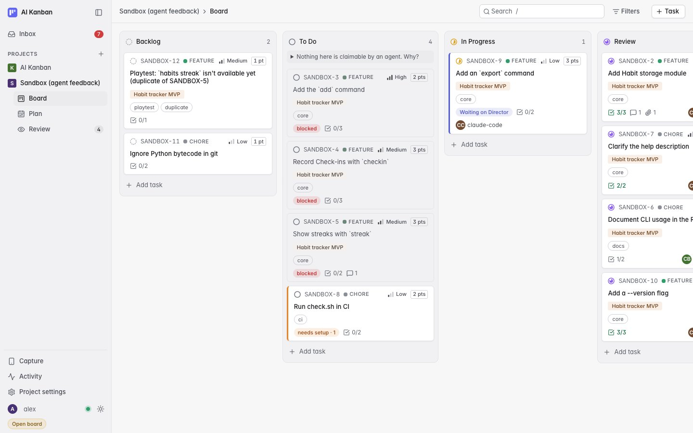
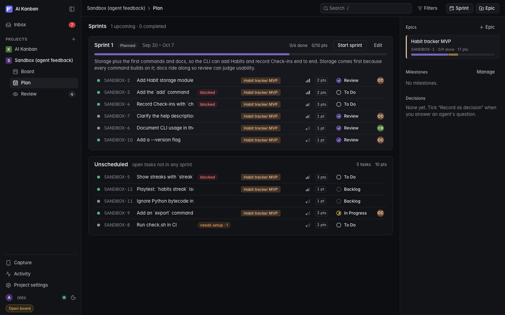
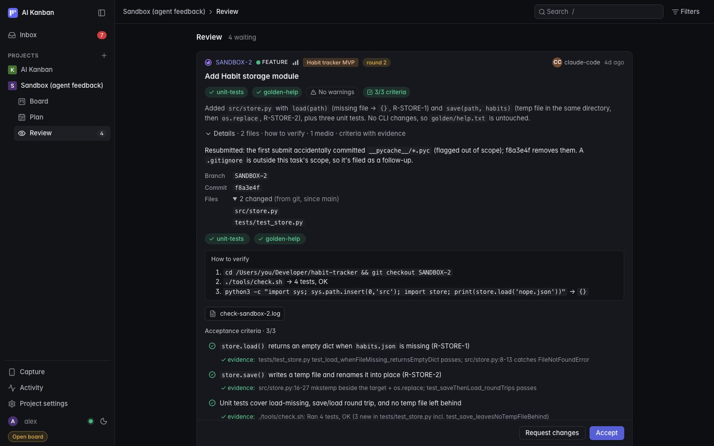
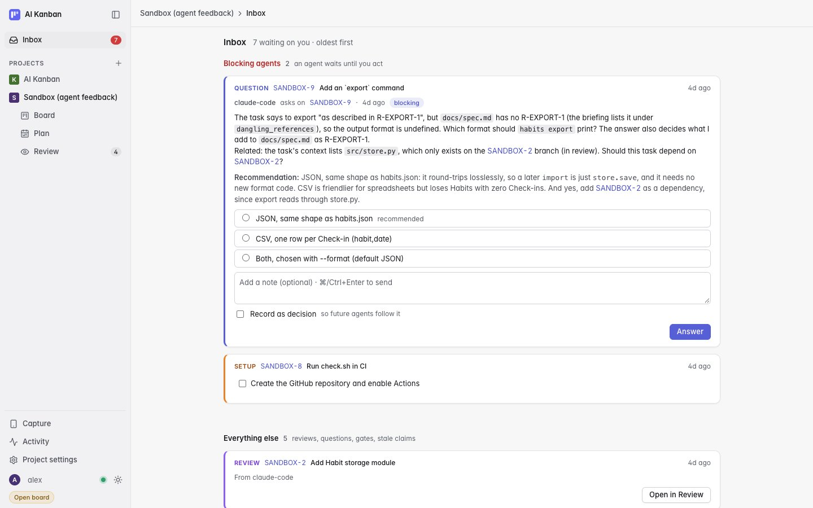
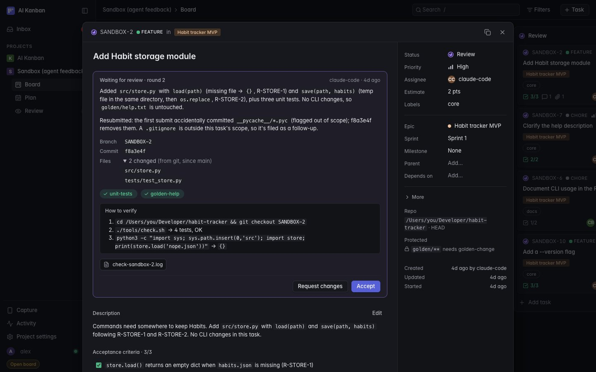
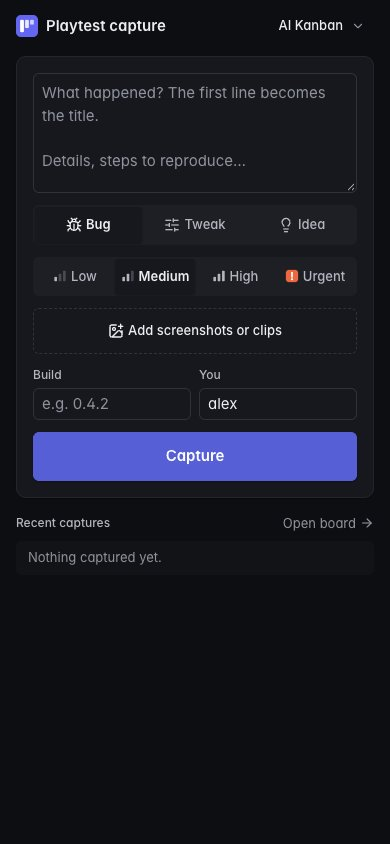

# Design system

The board's look in one place: the tokens every style is built from, what each is for, and the rules that keep
it calm. The target is Linear: dark first with a light theme of equal quality, surfaces separated by lightness
more than by borders, 1 px hairlines, compact 13 px text, one accent color, and color used only for meaning
(status, priority, attention).

All tokens live at the top of [`public/styles.css`](../public/styles.css). Components reference tokens only:
`test/design-tokens.test.js` fails on a raw hex color, font size or radius outside the token blocks, and on a
text color that drops under 4.5:1 on its surfaces.

## Themes

`public/theme.js` runs in `<head>` before the page paints and sets `data-theme` on `<html>`: the saved choice
(`localStorage["kanban.theme"]`: `light` or `dark`), or the system setting when there is none, following system
changes live. The theme button in the header cycles System → Light → Dark.

`:root` holds the dark theme (the default) and every non-color token; `:root[data-theme='light']` overrides only
colors. Both the board and the Capture page load the same script and stylesheet.

## Type

Inter, served from `public/fonts/` (400, 500, 600 and 400 italic, with `Inter-LICENSE.txt`, SIL OFL 1.1). No page
loads anything from another host. Code, branches and paths use the system monospace stack.

| Token | Value | Use |
|---|---|---|
| `--text-xs` | 11 px | Chips, labels, badges, meta counts, uppercase kind labels |
| `--text-sm` | 12 px | Secondary text: card meta, section headings, timestamps, inline code |
| `--text-md` | 13 px | The UI base: body, buttons, inputs, card titles, rows |
| `--text-lg` | 15 px | Dialog and view titles, sprint names, the Capture page's inputs (so iOS doesn't zoom) |
| `--text-xl` | 20 px | The task title in the task view, empty-state headings |
| `--weight-regular` / `--weight-medium` / `--weight-semibold` | 400 / 500 / 600 | Body / controls, card titles, emphasis / headings |
| `--leading` / `--leading-tight` | 1.5 / 1.3 | Body text / titles |
| `--tracking-caps` | 0.04em | The few uppercase labels (task type, Inbox kind) |

Keys, counts and estimates use tabular figures (`font-variant-numeric: tabular-nums`, on `.key`, `.count`,
`.tab-count`, `.estimate`, `.task-link`), so columns of numbers line up.

## Space and size

A 4 px scale: `--space-1` 4 · `--space-2` 8 · `--space-3` 12 · `--space-4` 16 · `--space-5` 20 · `--space-6` 24 ·
`--space-8` 32 · `--space-10` 40 px. Controls are `--control-h` (28 px) tall, list rows `--row-h` (34 px).
Borders are `--hairline` (1 px); focus rings `--focus-ring` (2 px).

## Radii

| Token | Value | Use |
|---|---|---|
| `--radius-sm` | 3 px | Chips with square corners (epic, estimate), inline code, type marks, segmented-control thumbs |
| `--radius-md` | 6 px | Buttons, inputs, cards, rows, menus |
| `--radius-lg` | 10 px | Columns, dialogs, sprints, Review and Inbox cards |
| `--radius-full` | round | Pills, avatars, status dots |

## Color

Surfaces step up in lightness in the dark theme (and toward white in the light one); borders are hairlines that
only separate what lightness can't.

| Token | Dark | Light | Use |
|---|---|---|---|
| `--bg` | `#0d0e11` | `#f7f7f8` | The page canvas |
| `--surface-1` | `#121317` | `#f1f1f3` | Header, columns, side panels, the task view's property column |
| `--surface-2` | `#17181d` | `#ffffff` | Cards, dialogs, inputs, sprints |
| `--surface-3` | `#1e1f25` | `#ebebee` | Hover, chips, inline code, segmented-control track |
| `--surface-4` | `#26272e` | `#e2e2e6` | Pressed, progress-bar track, toasts |
| `--border` / `--border-strong` | `#24252c` / `#30323a` | `#e3e3e7` / `#d2d2d8` | Hairlines / input and button outlines |
| `--text-1` | `#ededf0` | `#17181c` | Primary text |
| `--text-2` | `#b3b6bf` | `#484b54` | Secondary text, labels, priority labels |
| `--text-3` | `#8e929c` | `#5b5f68` | Tertiary: keys, meta, timestamps, placeholders |
| `--accent` / `--accent-hover` / `--accent-active` | `#575fd6` / `#6168e0` / `#4c53b8` | `#575fd6` / `#4d55cc` / `#444bb5` | The one accent: primary buttons (rest, hover, pressed), focus, selection, drop targets |
| `--accent-text` | `#9ba3ff` | `#4850c4` | Links and accent-colored text |
| `--accent-weak` | accent at 22% | accent at 12% | Selected and "Director" tints |
| `--on-accent` | `#ffffff` | `#ffffff` | Text on accent and danger fills, avatar initials |
| `--danger` / `--danger-text` | `#d23c3c` / `#ff8080` | `#d23c3c` / `#b92525` | Destructive fills / blocked, failed, dangling |
| `--success-text` | `#5fcf98` | `#106a3e` | Passed checks, met criteria, recorded decisions |
| `--warning` / `--warning-text` | `#e8b449` / `#e8b449` | `#e0a526` / `#7d5200` | Stale, rework, handoff warnings |
| `--attention` / `--attention-text` / `--on-attention` | `#f2994a` / `#f5a262` / `#1a1205` | `#e8832a` / `#9c440a` / `#1a1205` | Things only the Director can unblock (setup steps), Send back |
| `--review-text` | `#b99bfb` | `#6d2fd9` | The Review kind in the Inbox |
| `--info-text` | `#7ab4ff` | `#1a58b8` | Resume notes, "your task" gates |
| `--overlay` | black 62% | slate 32% | Behind dialogs |

Semantic colors for icons, dots and bars (never for text):

| Token | Use |
|---|---|
| `--c-backlog`, `--c-todo`, `--c-in_progress`, `--c-review`, `--c-done` | Status icons, column dots, progress bars |
| `--p-urgent`, `--p-high`, `--p-medium`, `--p-low` | Priority icons. Only urgent is colored; the others are neutral, as in Linear |
| `--type-task`, `--type-feature`, `--type-bug`, `--type-chore`, `--type-spike` | The small type mark on cards |
| `--epic-fg` / `--epic-bg` | Saturation and lightness for epic chips; the hue comes from the epic's key |
| `--avatar` | Saturation and lightness for avatars; the hue comes from the name |

Tinted chips (a status or attention color mixed at 10–22% into the surface, with its `-text` shade on top) are
measured on the rendered page; see the contrast audit below.

### Contrast

Every text token against every surface it is used on, lowest ratio shown (WCAG AA needs 4.5:1 for small text).
`node test/design-contrast.js` prints this table; the token test enforces it.

| Text token | On | Dark (min) | Light (min) |
|---|---|---|---|
| `--text-1` | `--bg`, `--surface-1`, `--surface-2`, `--surface-3` | 14.06:1 | 14.91:1 |
| `--text-2` | `--bg`, `--surface-1`, `--surface-2`, `--surface-3` | 8.11:1 | 7.32:1 |
| `--text-3` | `--bg`, `--surface-1`, `--surface-2`, `--surface-3` | 5.28:1 | 5.38:1 |
| `--accent-text` | `--bg`, `--surface-1`, `--surface-2`, `--surface-3` | 7.10:1 | 5.48:1 |
| `--danger-text` | `--bg`, `--surface-1`, `--surface-2`, `--surface-3` | 6.77:1 | 5.26:1 |
| `--success-text` | `--bg`, `--surface-1`, `--surface-2`, `--surface-3` | 8.50:1 | 5.60:1 |
| `--warning-text` | `--bg`, `--surface-1`, `--surface-2`, `--surface-3` | 8.65:1 | 5.73:1 |
| `--review-text` | `--bg`, `--surface-1`, `--surface-2`, `--surface-3` | 7.16:1 | 5.77:1 |
| `--info-text` | `--bg`, `--surface-1`, `--surface-2`, `--surface-3` | 7.67:1 | 5.64:1 |
| `--attention-text` | `--bg`, `--surface-1`, `--surface-2`, `--surface-3` | 8.00:1 | 5.44:1 |
| `--on-accent` | `--accent`, `--accent-hover`, `--accent-active`, `--danger` | 4.60:1 | 4.72:1 |
| `--on-attention` | `--attention` | 8.33:1 | 6.81:1 |

Generated hues are checked over all 360 hues: avatar initials (`--on-accent` on `hsl(h 40% 32%)`) are at least
5.04:1, and epic chips at least 6.17:1 (dark) and 5.05:1 (light).

### Measured on every view

The token table covers token pairs; tinted chips (`color-mix()`), opacity and stacked backgrounds only show up
on the page. So every visible text (and every input's value or placeholder) was also measured in headless
Chrome on a copy of the board, with its real color and composited background, in both themes (KB-46).
Lowest ratio per view on this branch, against `main` before the design system:

| View | Dark before | Dark now | Light before | Light now |
|---|---|---|---|---|
| Board | 2.37 | 4.72 | 2.02 | 4.66 |
| Plan | 3.66 | 5.67 | 2.00 | 4.66 |
| Review | 3.18 | 4.72 | 2.00 | 4.72 |
| Inbox | 3.18 | 4.72 | 2.02 | 4.72 |
| Task view | 2.37 | 4.72 | 2.02 | 4.66 |
| Capture | 3.18 | 5.23 | 3.23 | 5.23 |
| Menus, ⌘K palette, filters, activity, toasts, shortcut sheet, phone board | – | 4.72 | – | 4.66 |
| Plan → Completed sprints, expanded (rows hovered) | 4.44 (4.17) | 5.96 (5.28) | 4.13 (3.90) | 5.01 (5.01) |
| Milestones dialog, closed milestone | 3.45 | 5.69 | 3.24 | 6.40 |

Nothing is under AA now (it was up to 43 texts per view before). The lowest resting pairs are the
`--on-accent` fills (4.72:1) and, in light, `--danger-text` on a tinted "blocked" chip (4.66:1).
Hover and pressed states were probed the same way. The lowest is a hovered primary button in dark
(`--on-accent` on `--accent-hover`, 4.60:1, as in the token table). The one miss, a pressed primary button
in light (3.97:1 from a `color-mix()` toward the background), now uses `--accent-active` (7.19:1).

The last two rows only appear once a project has a completed sprint or a closed milestone, so they were
measured on a board copy seeded with both. Both used to be dimmed with `opacity`, which pulled every text
in them under AA. They now step back with tokens instead: a completed sprint sits on `--surface-1` with
its title in `--text-2`, and a closed milestone has a dashed border, its name in `--text-2` and the
"closed" label. Don't dim text with `opacity`; pick a quieter token.

## Elevation and motion

| Token | Use |
|---|---|
| `--shadow-1` | Resting cards, buttons, the selected segment |
| `--shadow-2` | Dialogs, menus, toasts (includes a hairline ring, so they read on any surface) |
| `--motion` | 120 ms `cubic-bezier(0.2, 0, 0, 1)`: every hover, press and appear transition |

## Rules

- Add a token before adding a value. A new text color needs a shade per theme that passes 4.5:1 on the surfaces
  it will sit on; add it to `TEXT_PAIRS` in `test/design-contrast.js`.
- Color carries meaning only: status, priority, attention. Decoration stays neutral.
- Separate with lightness first (a surface step), a hairline second, a shadow only for things that float.

## Views

| Board (dark) | Board (light) |
|---|---|
|  |  |

| Plan (dark) | Review (dark) |
|---|---|
|  |  |

| Inbox (light) | Task view (dark) |
|---|---|
|  |  |

Capture, on a phone (dark):

